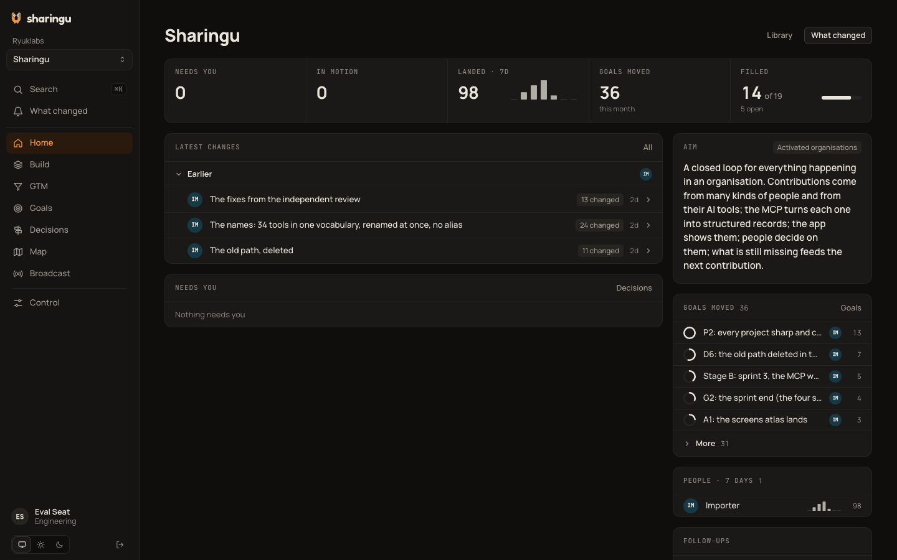
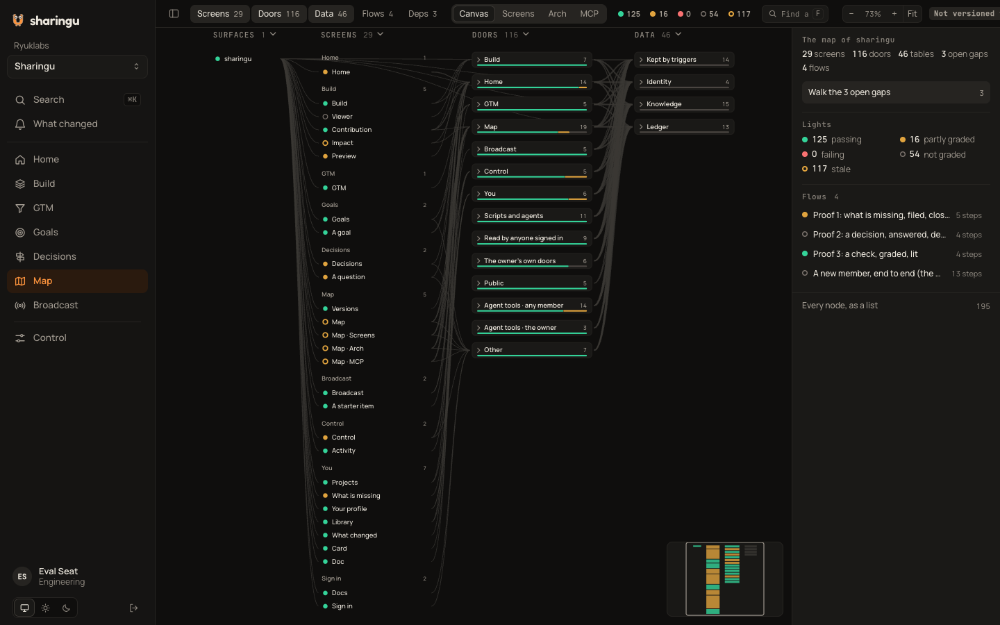
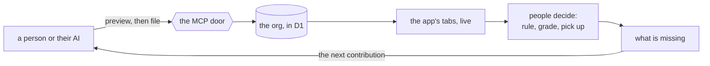

# sharingu

A shared company brain for people and their AI tools. People and agents file **contributions** through one MCP door;
sharingu stores them in their org and shows them live in the app; people decide on them; what is still missing feeds the
next contribution. One platform serves every org: one Cloudflare worker and one database, each org at its own address
and walled from the others, the app (eight tabs), the REST API and the MCP door. It runs at
**`https://agent.sharingu.xyz`** (also `agent.ryuklabs.io`), hosted-only: sharingu is proprietary (© Ryuk Labs).

## The loop

Three loops are the product's proof, and all three run on live:
**missing** → file what it names → it shows and the item closes; **decisions** → respond → the question shows ruled
at once; **a check** → `submit_grade` with proof → the check lights its map node, and a later change makes it stale
until a regrade.

## Quickstart

A new team starts in four steps ([`docs/INSTALL.md`](docs/INSTALL.md), the same on the site's docs page and in the
plugin's README):

1. **Join and connect** — the beta holds 50 orgs, through the waitlist: we approve each org and hand you a one-time
   sign-up code by hand (nothing is mailed). Sign up at `https://agent.sharingu.xyz/signup`, create your org and its
   first project at `/orgs/new`, then connect your AI to `https://agent.sharingu.xyz/mcp` (the table below).
2. **Your org, its project, its people** — Control's Invite gives each person a one-time invite link (they choose their
   own passphrase); roles Admin, Member and Partner; seven hats.
3. **Fill the product side** — your AI runs the skill `fill-the-product-side` over the code, docs and tickets.
4. **Fill the GTM side** — your AI runs `fill-the-gtm-side` over the apps you connected to it: summaries and links only.

Every write is `preview`, then the write tool each item names (`file_contribution`, `save_knowledge`,
`remove_knowledge`); the door teaches the rest (`whoami`, then `missing` with a project).

## Clients

| Client | Setup |
|---|---|
| **Claude Code** | the plugin: `claude plugin marketplace add ryuk-labs/sharingu-plugin`, then `claude plugin install sharingu@sharingu`; it signs in on connect, no key (a seat's key: `claude mcp add sharingu --transport http https://agent.sharingu.xyz/mcp --header "Authorization: Bearer <your-key>"`) |
| **Claude Desktop / claude.ai** | Add to Claude (the site's button prefills the connector), or Settings → Connectors → add `https://agent.sharingu.xyz/mcp` → Connect → sign in on the platform's page (your account's passphrase: every org you have a seat in; a seat's key: that seat) |
| **ChatGPT** | chatgpt.com/plugins → Add custom MCP server → `https://agent.sharingu.xyz/mcp` → sign in on the platform's page |
| **Codex** | a streamable HTTP server: `https://agent.sharingu.xyz/mcp` + the `Authorization: Bearer` header |
| **Plain HTTP** | the REST API takes the same bearer; `GET /whoami` proves it; `GET /capabilities` lists every door |

A connection that reaches several orgs acts in its current one; a call names another with `orgSlug`, and `whoami`
lists them. Every write is **preview, then file** — the preview says what will land, where it shows and what it
reaches, and nothing is written until its write tool runs (`file_contribution`, `save_knowledge`, `remove_knowledge`).
Clients that render the door's confirm get a one-press file (a write tool's `fileOnConfirm`; `publish` and `equip` ask
the same way); preview, then the write tool, always works everywhere.
(Known client finding: Claude Code's desktop app currently auto-declines the confirm without rendering it, so its users
take the two-call path.)

## For agents and LLMs

The door teaches its own use: `whoami` says who you are and where your writes land, `missing` hands you the next
thing to file **with the exact call that files it**, `formats` shows every item's shape, and a built-in start-here
guide is served to every reader through the door. The repo-side references:

- [`llms.txt`](llms.txt) — the one-request index of this repo for a model.
- [`contracts/door.json`](contracts/door.json) — the generated contract: all 37 tools, their REST twins, shapes and
  refusals (never hand-edited; built by `engine/tools/make-door-contract.py`).
- [`docs/RELEASE-NOTES.md`](docs/RELEASE-NOTES.md) — what changes for a connected client.

## The repo

| Path | What it is | Start reading |
|---|---|---|
| `engine/` | the product: the worker (pages, API, MCP), its schema, scripts and tests | [`engine/README.md`](engine/README.md) |
| `contracts/` | the door's contract; `door.json` is generated from the engine's own registries | [`contracts/README.md`](contracts/README.md) |
| `docs/plan/` | the plan and the current state | [`docs/plan/README.md`](docs/plan/README.md) |
| `docs/` · `orgs/` | install paths · where an org starts | [`docs/INSTALL.md`](docs/INSTALL.md) · [`orgs/README.md`](orgs/README.md) |

Working on sharingu itself: an agent's session boot is [`CLAUDE.md`](CLAUDE.md), which imports
[`AGENTS.md`](AGENTS.md) — the map, the process and the laws (the MCP is the only input; D1 is the truth; no dead
code, no dead docs).

## Status

**Beta — the gate is green** ([`docs/plan/BETA.md`](docs/plan/BETA.md): every line with its proof on live). The hosted
platform signs people up by the operator's allowlist; teams join by invite with the one-page
[`docs/BETA-NOTE.md`](docs/BETA-NOTE.md), and the repo stays private until the Claude plugin. Next: limits and usage
per org, then the plugin — [`docs/plan/PLATFORM.md`](docs/plan/PLATFORM.md).

MIT ([`LICENSE`](LICENSE)) · security reports: [`SECURITY.md`](SECURITY.md) · contributing: [`CONTRIBUTING.md`](CONTRIBUTING.md)
